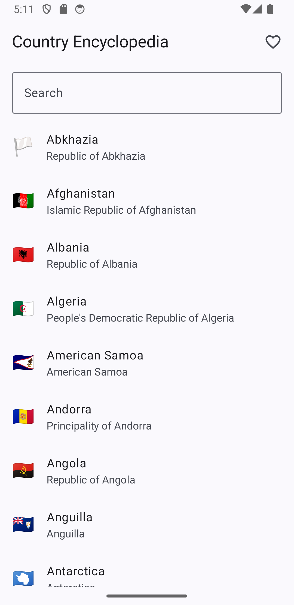
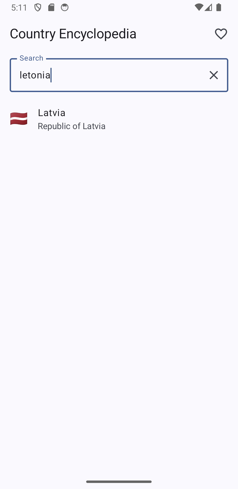
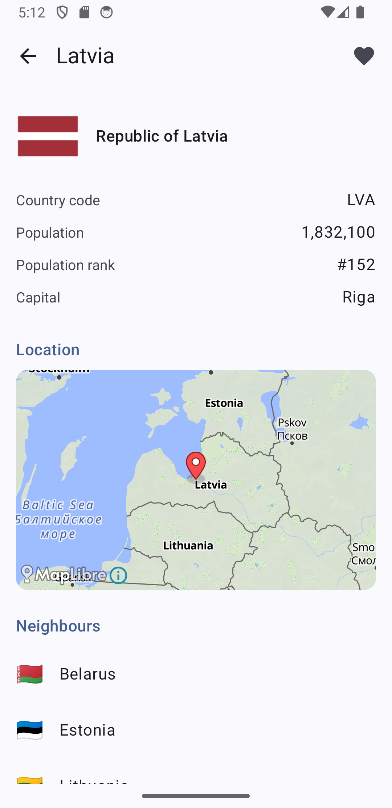
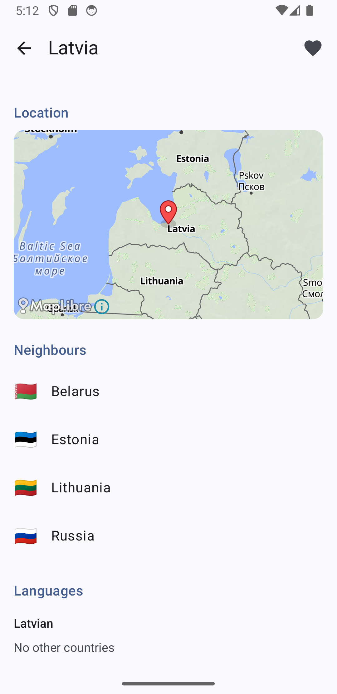

# Country Encyclopedia

An Android app for browsing and searching the world's countries, built with Kotlin and Jetpack Compose.
Data comes from the [REST Countries API v5](https://restcountries.com).

<p>
  
  
  
  
</p>

## Features

- **Country list** with flag emoji, common name and official name.
- **Search in many languages.** A country can be found by its common, official, native or alternative name,
  by any of the API's 26 translations, or by its ISO code. Search ignores case and accents, so
  `Läti`, `Letónia`, `letonia` and `LV` all find Latvia.
- **Country details**: flag image (from [flagsapi.com](https://flagsapi.com)), official name, country code,
  population, global population rank and capital.
- **Map** showing the capital (or the country's centre if there is no capital).
- **Neighbouring countries**: tap one to open its details.
- **Languages**, each with a list of other countries that speak it; tap one to open its details.
- **Favourites**:
  - Mark or unmark a country with the heart button on its details screen.
  - Favourite countries are marked with a heart in the list.
  - The heart button in the list's top bar shows **only favourites**; tap it again to show all countries.
  - **Search works inside favourites** too, with the same multi-language search.
- **Empty states**: clear messages when there are no favourites yet or when nothing matches the search.
- **Works offline** after the first start (except map tiles and flag images).

## Getting started

### Requirements

- Android Studio (a recent version that supports AGP 9.4)
- A device or emulator running **Android 8.0 (API 26)** or newer

### API key

The REST Countries API v5 requires a key.

1. Create a free account at [restcountries.com](https://restcountries.com) and copy your API key.
2. Open `local.properties` in the project root (Android Studio creates it on the first sync) and add:

   ```properties
   restCountriesApiKey=YOUR_KEY_HERE
   ```

3. Sync Gradle and run the `app` configuration.

`local.properties` is git-ignored, so the key never ends up in the repository. Gradle reads it at build time
and exposes it to the app as `BuildConfig.REST_COUNTRIES_API_KEY`. Without a key the app starts, but the
first download fails and the list shows an error with a **Retry** button.

### Running the tests

```bash
./gradlew test
```

## Tech stack

| Area | Library |
|---|---|
| Language | Kotlin |
| UI | Jetpack Compose, Material 3 |
| Navigation | Navigation Compose with type-safe routes |
| Dependency injection | Hilt |
| Networking | Retrofit, OkHttp, kotlinx.serialization |
| Local database | Room |
| Async | Kotlin Coroutines and Flow |
| Images | Coil |
| Map | MapLibre Android SDK with [OpenFreeMap](https://openfreemap.org) tiles |
| Tests | JUnit 4 |

## Architecture

The app follows the MVVM pattern recommended for Android, with a repository and a local database as the
single source of truth.

```
REST Countries API ──► CountriesApi (Retrofit)
                              │  CountryDto
                              ▼
                       CountryRepository ──► CountryDao (Room) ──► SQLite
                              │  CountryEntity (Flow)
                              ▼
                     ListViewModel / DetailViewModel  (StateFlow)
                              │
                              ▼
                     CountryListScreen / CountryDetailScreen  (Compose)
```

```
app/src/main/java/lv/dreimanis/countryencyclopedia/
├── data/
│   ├── remote/        API interface and DTOs (match the JSON)
│   ├── local/         Room entities, DAO, database, type converters
│   ├── CountryMapper.kt       DTO → entity, search text
│   └── CountryRepository.kt   the only data source the UI uses
├── di/                Hilt modules (network, database)
└── ui/
    ├── list/          list screen + ViewModel
    ├── detail/        details screen, ViewModel, map
    └── navigation/    routes and NavHost
```

- **Screens** only draw state and report events (`onCountryClick`, `onBack`). Navigation is decided in one place,
  `AppNavHost`.
- **ViewModels** expose `StateFlow`s that the screens collect with `collectAsStateWithLifecycle()`.
- **The repository** hides where data comes from. The UI never calls the API directly.

## Design decisions

### Download everything once, then work locally

There are only 254 countries, and the free API plan allows 1,000 requests per month and 100 results per
request. On the first start the app downloads all countries in **3 paged requests** (`offset` 0, 100, 200) and
stores them in Room. After that, every feature (search, rank, neighbours, same-language countries, favourites)
is a local database query, so the app is fast, works offline and makes no more API requests.

The countries are saved only after all pages have downloaded. If a request fails halfway, nothing is stored and
the next attempt starts cleanly instead of leaving an incomplete list.

The request uses `response_fields` to ask only for the fields the app needs, which keeps responses small.

### Search

When saving, each country gets a `searchText` column containing all its names (common, official, native,
alternative, all translations) and its ISO codes, lowercased and with accents removed using
`java.text.Normalizer`. The user's query is normalised the same way, so search is a single
`LIKE '%query%'` query. The expensive work is done once when saving, not on every keystroke.

### Population rank

The rank is calculated in SQL as "the number of countries with a larger population, plus one". Countries without
population data are excluded and get no rank.

### Favourites in a separate table

Favourites are stored in their own `favorites` table instead of a flag on the country row. The `countries` table is
a copy of API data and may be replaced; the user's favourites should never be lost when that happens.

### MapLibre instead of Google Maps

MapLibre is a native Android map SDK that needs no API key or billing account, so the project runs right after
cloning. The map uses `TextureView` mode so that it fades out together with the rest of the screen during
navigation animations (the default `SurfaceView` stays visible until the screen is removed).

## Known limitations

- **India is #1, not China.** The task mentions China as #1, but that has changed.
- **Database migrations are destructive.** When the database version changes, Room recreates the database.
  Countries are downloaded again automatically, but favourites are lost. A production app would add proper
  Room migrations.
- **Map tiles and flag images need an internet connection.** Everything else works offline after the first start.
- **No manual refresh.** Data is downloaded only when the database is empty. Country data rarely changes, but a
  pull-to-refresh would be a natural next step.

## Tests

Unit tests cover the logic that is easiest to get wrong:

- `normalizeForSearch` removes accents and lowercases (`Letónia` → `letonia`, `ŽĀMBĪĀ` → `zambia`, `Łotwa` → `lotwa`).
- `toEntity` picks the primary capital and adds translations to the search text.
